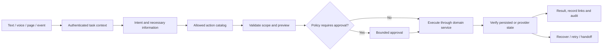

# Kodewaves AI control and complete business platform plan

Updated: 28 October 2026. Status: designed direction; implementation and acceptance remain open. This extends the [business expansion roadmap](BUSINESS_PLATFORM_EXPANSION_ROADMAP.md) and preserves the release gates in [the commercial roadmap](COMMERCIAL_CLIENT_BUNDLE_ROADMAP.md). It does not replace the existing platform or authorize merging the active voice branch.

## Intended product

Give every authorized operator one assistant that can explain the platform, find records, configure permitted settings, build agents and workflows, operate connected business modules, investigate failures and complete follow-ups. A user can start from text, voice, an event or a page. The assistant keeps the same task and business state across those entry points, reports the actual result and hands control to a person when needed.

AI coverage is a requirement of every module. A screen alone, a model reply, an action proposal or a successful HTTP response does not prove completion. An operation is complete when its intended business state is verified and the user can see what happened.

## What exists and what must be built

The current source has workflow authoring/catalog MCP tools (`api/mcp_server/server.py`), API-key authentication (`api/mcp_server/auth.py`), workflow MCP tool execution, text workflow testing, CRM, appointments, forms, widgets, campaigns, knowledge, billing, organization and owner routes. Source presence does not establish accepted customer journeys. The registered authoring MCP tools do not provide complete platform control today. There is no verified platform-wide assistant covering all of these operations.

Reuse those domain services and permission checks. Add one shared action layer and durable task execution; expose them to the assistant and existing panels. Avoid an independent AI database or a second set of business rules.

## Experience in every panel

- A persistent assistant opens from the public site, workspace and permitted administration surfaces. Public visitors get public knowledge and narrowly scoped lead/support actions; they never gain workspace tools.
- In an authenticated session, page context contains the current organization, permitted record identifiers and task state. Switching organizations invalidates the prior tool context and pending approvals. A new organization requires a newly authorized task context.
- The assistant can explain a page, find data, propose a change, show a structured preview, execute an authorized operation and link to its result. A conversation can continue after navigation without repeating completed work.
- Each action shows understandable states: preparing, needs information, awaiting approval, running, completed, failed or cancelled. Long jobs continue through a queue and show their real progress. Reloading or reconnecting restores the same task.
- Users can inspect affected records, pause or cancel unstarted steps, retry a failed step safely, hand the task to staff and see a permanent activity record. A queued action is never presented as already sent or completed.
- Typed text, browser audio and telephone use the same business actions and memory scope. Voice has its own turn/playback lifecycle; tool completion cannot inject stale audio into a newer turn.

## AI authority and owner control

| Principal | Permitted scope | Required boundary |
|---|---|---|
| Public visitor or website agent | Public answers, permitted form intake, available booking slots, scoped support intake | Short-lived channel capability; no internal data or administrative authority |
| Workspace member | The member's allowed records, tasks and actions | Organization, role and record authorization at every invocation |
| Workspace administrator | Permitted users, teams, branding, connections and business configuration | Cannot change owner licensing, owner keys, billing policy or hidden owner functions |
| SaaS owner/superadmin | Authorized platform operations, installation policy, plans, limits, health and support | Separate owner action registry, stronger authentication for consequential operations, full audit |
| Scheduled automation | Actions granted by an authorized sponsor within a saved policy | Revalidate sponsor, role, entitlement, target and spending policy at execution time |

Client images contain workspace actions only. Owner prompts, tools, routes and private keys remain in the owner deployment. A model never receives a master token that bypasses these boundaries. Model changes do not alter authority. Role revocation, license revocation and plan downgrade stop newly forbidden actions even if they were queued earlier.

Owner settings determine available modules, providers, model budgets and automation policy. Customer administrators control their licensed workspace. Brand and theme changes use supported settings/content APIs, preserving the protected application files.

## One execution path

1. Resolve identity and organization server-side. Treat webpage text, uploaded documents, social messages, transcripts and tool output as data, never authority to grant permissions or change system policy.
2. Discover only actions allowed by the principal's role, edition, active plan, connection permissions and capability policy. For large catalogs, retrieve the relevant tools instead of sending every tool definition to the model.
3. Collect necessary information. Resolve ambiguous contacts, branches, dates/time zones and destinations before mutation. Keep record IDs separate from natural-language descriptions.
4. Validate inputs and produce a structured preview with affected records, external recipients, cost/usage, timing and recovery options.
5. Apply an action policy. Reads and authorized reversible drafts may execute directly. Publishing, external sending, calls, refunds, bulk edits, deletions, permission changes and owner license actions require explicit approval unless an authorized standing policy covers the exact action and bounds.
6. Bind approval to principal, organization, action version, validated input hash, destination, cost ceiling and expiry. A changed destination, amount or scope requires a fresh approval. Recheck permission when the task executes.
7. Persist task and action state, use an idempotency key, execute through the same domain service the panel uses, and verify the resulting record/provider status. Distinguish accepted, sent, delivered, booked and failed states.
8. Return verified outcomes and links. On partial completion, show which operations committed and which did not. Never replay completed sends or purchases when retrying a later failed step.

## Action contract and durable execution

Every module registers actions with: stable name and version; typed input/output schemas; organization/record scope; required role and entitlement; read/write and external-effect classification; approval policy; idempotency semantics; concurrency/version guard; deadline; rate and spend limits; provider connection requirements; verification method; safe cancellation point; compensation or recovery method; audit/redaction rules; and supported languages/capabilities.

Proposed persistence: `assistant_tasks`, `assistant_action_runs`, `assistant_approvals` and task events, all organization-scoped. Domain records remain in their owning tables. Store actor, sponsor, input hash, operation ID, state transitions, provider correlation ID and verified result. Store secret references instead of credential values. Human tasks and scheduled tasks use the same authorization path.

Use an outbox/worker design for external effects. Reserve quotas before work, commit/release them atomically, and record ambiguous provider timeouts as unknown until reconciled. Retry transient failures with bounds and backoff. Use provider idempotency when available; when it is unavailable, reconcile through the provider before repeating a possibly successful action. Use revision checks for conflicting edits and an execution lease to prevent duplicate workers. A multi-step business task uses explicit compensation; a remote email or completed call cannot be undone by rolling back a local transaction.

## Full module coverage

The list below is a starting catalog, not a fixed limit. Future modules and industry extensions must satisfy the same action, UI, audit and acceptance contracts.

| Area | AI operations to support | Proof of a usable journey |
|---|---|---|
| Onboarding and setup | Explain plans, workspace creation, module selection, import preview, connection setup and readiness checks | A new customer reaches its first accepted business task; missing credentials have a working reconnect/setup route |
| Agents and workflows | Create drafts, select actual supported models/voices/languages, add tools, validate, simulate, compare versions, publish and restore approved versions | User creates and tests an agent through the assistant; published behavior matches the approved version |
| Knowledge and content | Upload/index, retrieve with permissions, show source, find stale/conflicting content, draft updates and request review | Answers cite accessible source records and cannot expose another workspace's documents |
| CRM and sales | Find/qualify leads, deduplicate with merge review, update deals, assign tasks, generate quotes and follow-ups | An inquiry progresses to a verified follow-up/booking or qualified opportunity without duplicate contacts |
| Service and support | Triage tickets, search knowledge, assign/escalate, draft/reply, summarize and measure SLA | A real customer request is resolved or handed to a named staff queue with its history |
| Appointments and resources | Check availability, resolve time zones, book/reschedule/cancel, reminders and waitlist | Concurrent requests cannot double-book; the user receives the final confirmed slot |
| Website and public widgets | Configure domain-scoped embeds/forms, capture inquiries, support and booking | A third-party website produces a scoped conversation/lead and staff can continue it |
| Unified inbox and channels | Connected WhatsApp, email, social, SMS, web and supported messaging operations; routing and handoff | Each supported adapter passes connection, inbound/outbound, delivery, duplicate, opt-out and reconnect tests |
| Marketing and campaigns | Audience preview, consent checks, content drafts, approved schedules, pacing, pause and reconciliation | Exact audience/destination/cost is approved; stop works and reconnect never resends completed items |
| Commerce and orders | Product lookup, order status, quotes, returns requests and approved order/refund changes | External order/payment state agrees with local records and the assistant's result |
| ERP and inventory | Stock queries, suppliers, purchase orders, movements, replenishment proposals and accounting export | Concurrent stock changes preserve a reliable ledger; financially consequential actions need policy approval |
| Projects and field operations | Tasks, service jobs, dispatch, staff/resource schedules, status and client portal | Assigned work and completion evidence remain visible to staff and authorized customers |
| Industry workspaces | Clinic, retail, education, hospitality, property, automotive, logistics, professional services, HR and further extensions | Each selected vertical has a complete accepted customer/staff journey and its own permissions; sensitive decisions are handed to qualified staff |
| Reporting and analytics | Explain defined metrics, scoped queries, charts, exports, scheduled reports and anomaly triage | Every number has a defined source/time range; exports obey role and tenant permissions |
| Workspace administration | Branding, permitted users/roles, branches, connections, working hours and settings | Saved changes persist and refresh every affected panel; privilege changes require approval |
| Billing and usage | Explain actual plan/usage, estimate task cost, payment setup and approved purchases | Amount, currency, term and payment status are provider-verified; the model cannot grant itself credits |
| Owner control and operations | Plans, installations, signed license issue/renew/revoke, integrity alert triage, health and support | Owner-only actions never ship in client images; actions are audited and verified in both editions |
| Recovery and maintenance | Diagnose failures, prepare recovery/upgrade plans, approved maintenance actions and status | A restored/upgraded isolated deployment preserves customer data and reports the correct version |

Channel features depend on each provider's supported authentication, permission and API capabilities. Confirm current official provider documentation before promising an operation. Ordinary WhatsApp consumer QR access, private social messages and every possible language are not assumed to be universally available.

## Conversation continuity and speed

Keep short-lived turn state separate from durable business facts. Names, booking details and choices become typed draft fields; unconfirmed transcriptions remain tentative. Store only permitted memory with visible retention/deletion controls. Summaries never overwrite authoritative business records.

For voice, preserve a complete user turn, reconcile partial/final STT, generate from the latest confirmed context, stream TTS in order and cancel stale generation/playback on a real interruption. Language switching and gender/voice preferences follow the agent's configured capabilities. Self-hosted and cloud backends share action behavior, while each advertises only tested language/model capabilities. Preserve the user's instruction not to probe paid provider keys merely to audit compatibility.

Measure endpoint detection, final transcription, model first token, first audio, tool wait, playback completion and total task time independently. Target 1–1.5 seconds from speech end to first useful audio for the hardware/models and loads that pass measurement. A slow external booking or payment is shown as a running operation; a quick acknowledgement is not counted as task completion. Cache public metadata/catalogs with invalidation and never replay a cached business answer or action for a different customer.

## Delivery order

| Phase | Deliverable | Exit gate |
|---|---|---|
| 0 — Current release | Finish customer bundle, licensing/integrity, owner boundary, branding/pricing and isolated install/recovery; obtain stable voice handoff | Existing commercial roadmap critical gates accepted; merge hold still respected |
| 1 — Inventory | Map every API/UI operation to a capability; mark missing backend, policy and recovery paths; prioritize complete journeys | Traceable module/action coverage matrix, agreed first workflows and resource budget |
| 2 — Shared action core | Typed registry, principal context, permissions/entitlements, task state, approval, audit, idempotency and queue | Cross-tenant denial, revoked permission, stale approval, duplicate retry and worker-restart tests pass |
| 3 — Platform assistant | Persistent contextual panel, task progress, drafts/previews, result links and staff handoff | One authenticated multi-page task survives reconnect and completes through domain services |
| 4 — Complete business slice | Website inquiry → CRM → staff assignment → appointment → approved channel follow-up | Real two-tenant end-to-end journey, duplicate webhook and failed-provider recovery accepted |
| 5 — Agent and voice operations | Same actions through text/browser/telephone; agent authoring and testing from the assistant | Browser gate then authorized phone tests; no repeated/cut/overlapping replies; supported language matrix recorded |
| 6 — Module expansion | Inbox, support, campaigns, commerce/ERP and chosen verticals, with provider adapters | Each module independently accepted using its core journey and failure/reconnect cases |
| 7 — Owner assistant | Owner-only action catalog and installation/alert/support workflows | No owner capability in customer images; exact approvals and immutable action evidence |
| 8 — Operational release | Load, recovery, upgrades, model budgets, accessibility, monitoring and release documentation | Accepted complete revision with tested capacity, backup/restore and rollback evidence |

Phase 1 design work may proceed during Phase 0 verification. New core action APIs must be developed in the isolated worktree and reconciled through a stable integration contract. Voice changes stay with their owner until its completion handoff. No shared checkout switching or unreviewed production merge.

## Acceptance checklist

- [ ] Every delivered panel operation is mapped to an action or an explicit user-only step with a reason; no nonfunctional AI buttons.
- [ ] Two tenants using identical record IDs and similar names cannot retrieve or mutate each other's data.
- [ ] Organization switches, role revocation and license/plan changes invalidate forbidden pending work.
- [ ] A retrieved page/message containing malicious instructions cannot trigger unauthorized tools or disclose secrets.
- [ ] The user sees the exact affected records, recipients, spend and schedule before a consequential action.
- [ ] A repeated event, client retry, model retry or worker restart does not duplicate its business effect.
- [ ] Concurrent edits, booking races and inventory races preserve domain invariants.
- [ ] A lost provider response is reconciled before retry; unknown outcomes are never reported as successful.
- [ ] Reload, network loss, worker restart and channel reconnect restore task state and preserve completed steps.
- [ ] Cancel/pause works at documented boundaries and results remain auditable.
- [ ] Public visitors, ordinary members, workspace admins and owners each pass their allowed and denied journeys.
- [ ] Browser and phone share the same confirmed business state and pass interruption, language and audio acceptance.
- [ ] Supported model/provider/language claims match recorded tests; measured latency distinguishes speech from tool time.
- [ ] Full theme/brand changes appear throughout public, user and admin panels through supported settings.
- [ ] Customer images exclude owner functions and pass licensing, integrity, upgrade and recovery acceptance.
- [ ] Every completion statement links to verified persisted/provider state; a queued action is shown as queued.

Maintain implementation status per action and journey: proposed → designed → implemented → verified → accepted. This document is the plan; the unchecked requirements remain work to deliver.
